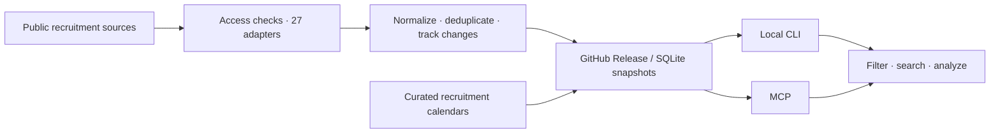

<p align="center">
  <a href="https://pypi.org/project/jobsearchradar/"></a>
  <a href="https://github.com/lijiaqi-AI-Product-Manager/job_radar/actions/workflows/ci.yml"></a>
  <a href="https://github.com/lijiaqi-AI-Product-Manager/job_radar/releases/tag/data-latest"></a>
  <a href="pyproject.toml"></a>
  <a href="LICENSE"></a>
</p>

<p align="center">
  <a href="README.md">简体中文</a> · English · <a href="README.ja.md">日本語</a> · <a href="README.ko.md">한국어</a> · <a href="README.es.md">Español</a> · <a href="README.fr.md">Français</a> · <a href="README.de.md">Deutsch</a> · <a href="README.ru.md">Русский</a>
</p>

**China's campus, internship and experienced-hire listings, with recruitment calendars. Download once. Query locally.**

Turn scattered public recruitment information into a traceable SQLite dataset. Filter by employer, city and graduation year, search original job descriptions, and follow the original application link. Use the CLI or MCP without an API key or a server to deploy.

<p align="center">
  <a href="#quick-start">Quick start</a> · <a href="#query-examples">Examples</a> · <a href="#data-and-coverage">Data & coverage</a> · <a href="docs/README.md">Documentation</a> · <a href="CONTRIBUTING.md">Contribute</a>
</p>

## See it in action


<sub>Results from the October 29–30, 2026 snapshots; original source text is preserved. Animation timing does not represent query latency. Check the latest data and original listing before applying.</sub>

## What you can do

| Your workflow | Included |
| :--- | :--- |
| Find relevant opportunities | Combine employer, city, role category, recruitment type and graduation-year filters |
| Read actual requirements | Search titles and original JD text; keep the source link |
| Follow recruitment activity | Application calendars and open / change / close history |
| Build your own tools | JSON by default, readable CLI tables, and nine MCP tools |
| Work with your own copy | Local SQLite queries, offline analysis, separate code and data releases |
| Assess the evidence | Separate official and aggregator sources; preserve missing values and reproducible counts |

## Quick start

Requires **Python 3.11+**. Supports Windows, macOS and Linux.

```bash
pip install jobsearchradar
jobradar update
jobradar search --company 复星医药 --type campus --grad-year 2027 --table
```

The package is **`jobsearchradar`**; the installed command is **`jobradar`**. The first update downloads the structured and JD databases. Later updates check the release version and skip downloads when current.

```bash
# Optional mirror for networks with slow GitHub downloads
jobradar update --mirror gitee
```

Data lives in `~/.cache/jobradar` by default. Set `JOBRADAR_HOME` to use another directory. See the [FAQ](docs/FAQ.md) for downloads and troubleshooting.

## Query examples

```bash
# Employer, recruitment type and graduation year
jobradar search --company 复星医药 --type campus --grad-year 2027 --limit 3 --table

# Match multiple terms in titles and original job descriptions
jobradar search --text "PyTorch 大模型" --type campus --limit 3 --table

# Internship roles by city and category, with duplicate variants folded
jobradar search --city 上海 --category 算法 --type intern --dedupe --table

# Recruitment calendar and recent activity
jobradar calendar --group 阿里巴巴 --grad-year 2027 --table
jobradar diff --days 7 --types open --table
jobradar diff --days 7 --by category --company 腾讯
jobradar trends 美团 --step-days 7
```

Omit `--table` for JSON output. Use `jobradar show <job_id>` for a listing and its JD, or `jobradar doctor` to inspect local data. Employer names, source descriptions and many taxonomy values are Chinese; see the [field reference](skill/jobradar/references/fields.md) and `jobradar --help`.

## Connect with MCP

```bash
pip install "jobsearchradar[mcp]"
jobradar update
```

Add this stdio service to an MCP-compatible client:

```json
{
  "mcpServers": {
    "jobradar": {
      "command": "jobradar-mcp"
    }
  }
}
```

Nine tools cover search, job details, recent changes, new roles by category, company comparisons, trends, data status, calendars and statistics. Pass `JOBRADAR_HOME` through the service's `env` if you use a custom data directory. Ensure the client can find the installed `jobradar-mcp` executable.

For CLI-based integrations, see the [query workflow](skill/jobradar/SKILL.md).

## Data and coverage

**Source configuration · October 31, 2026**

| Metric | Value | Definition |
| :--- | ---: | :--- |
| Enabled sources | **2,242** | Enabled source configurations |
| Configured companies | **2,201** | Distinct companies represented by enabled sources |
| Adapters | **27** | Shared platforms and custom recruitment sites |
| Core target coverage | **931 / 1,655 · 56.25%** | Configuration coverage of a fixed target pool |
| Official / aggregator | **606 / 325** | Official-first classification, without double counting |

**Verified release snapshot · `2026-10-29T23:17:25Z`**

**294,483 total job records**, including **276,008 open records**, with original JD text for **97.3%** of open records. The calendar sample contains **4,874 entries**, including **2,078 manually curated entries**. These are dated snapshot statistics. Use `jobradar stats` and the latest [data release](https://github.com/lijiaqi-AI-Product-Manager/job_radar/releases/tag/data-latest) for current figures.

Configured coverage does not mean an employer is hiring today. An aggregator recruitment notice may describe multiple roles. Missing dates remain empty; a university notice's display expiry is kept separate from an employer's application deadline. See [coverage methodology and limitations](docs/COVERAGE.md).

<details>
<summary><strong>Data files and updates</strong></summary>

| File | Content |
| :--- | :--- |
| `jobs.db` | Structured listings, status and change events |
| `jd_text.db` | Original responsibilities and requirements |
| `calendar.db` | Recruitment projects, years, tracks, dates and sources |

Scheduled GitHub Actions publish `data-latest`. The CLI downloads snapshots and runs queries locally. Failed crawls do not directly close listings. Always check `data_as_of` and the original source.

The main branch adds FTS5 trigram indexes while preserving literal substring matching; short terms fall back to LIKE. Indexes are built locally on first use by the newer client. A local 294k-record sample took about one minute and added about 199 MB. Public exports retain the older compatible database format. See [release and compatibility notes](docs/RELEASE.md).

</details>

## Architecture



Collection runs on GitHub Actions. Queries run on your computer. CLI and MCP share one query layer and the same filtering rules.

## Contribute

Help add permitted public sources, correct employer attribution or dates, improve adapters, report reproducible issues, or refine translations.

```bash
git clone https://github.com/lijiaqi-AI-Product-Manager/job_radar.git
cd job_radar
uv sync --frozen --all-extras
uv run pytest
uv run ruff check .
```

Start with the [contributing guide](CONTRIBUTING.md), [development guide](docs/DEVELOPMENT.md) and [roadmap](docs/ROADMAP.md). Reports are most useful with the command, data timestamp and original source URL.

If job_radar saved you a few trips across recruitment sites, a **Star** or a recommendation to a job-seeking friend helps others discover it.

## Documentation and license

[Documentation](docs/README.md) · [FAQ](docs/FAQ.md) · [Coverage](docs/COVERAGE.md) · [Changelog](CHANGELOG.md) · [Compliance](COMPLIANCE.md)

Code is licensed under [MIT](LICENSE). Recruitment text and third-party content remain subject to their owners' rights; the code license does not grant additional rights to that content. Collection respects public-access rules and does not bypass login walls, CAPTCHAs or access controls. See [data usage notes](docs/DATA-LICENSE.md).
