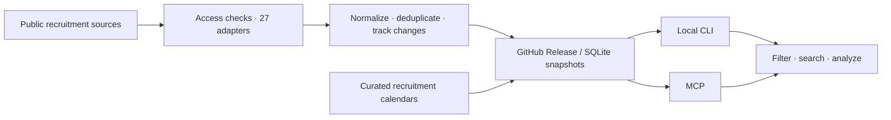

<p align="center">
  <a href="https://github.com/lijiaqi-AI-Product-Manager/job_radar/releases/tag/v2.2.2"></a>
  <a href="https://pypi.org/project/jobsearchradar/"></a>
  <a href="https://github.com/lijiaqi-AI-Product-Manager/job_radar/actions/workflows/ci.yml"></a>
  <a href="https://github.com/lijiaqi-AI-Product-Manager/job_radar/releases/tag/data-latest"></a>
  <a href="pyproject.toml"></a>
  <a href="LICENSE"></a>
</p>

<p align="center">
  <a href="README.md">简体中文</a> · English · <a href="README.ja.md">日本語</a> · <a href="README.ko.md">한국어</a> · <a href="README.es.md">Español</a> · <a href="README.fr.md">Français</a> · <a href="README.de.md">Deutsch</a> · <a href="README.ru.md">Русский</a>
</p>

**Give your everyday AI assistant a job-search skill.**

Tell it where you want to work, what you want to do and what matters to you. It can query China's graduate recruitment, internships, experienced-hire opportunities and recruitment calendars, read original requirements, and return candidates with source links.

**The recommended path is an agent platform with skills or local tools.** Complete the platform's initial setup, then ask in everyday language. WorkBuddy and Qianwen Office provide skill-import paths; Kimi's local agent mode, Claude Desktop and ChatGPT need the appropriate tool-enabled mode. See [platform routes and scope](docs/PLATFORMS.md). The query tools need no separate API key; your assistant provider may charge for its service.

<p align="center">
  <a href="#quick-start">Quick start</a> · <a href="#query-examples">Examples</a> · <a href="#data-and-coverage">Data & coverage</a> · <a href="docs/README.md">Documentation</a> · <a href="CONTRIBUTING.md">Contribute</a>
</p>

## See it in action


<sub>Results from the October 29–30, 2026 snapshots; original source text is preserved. Animation timing does not represent query latency. Check the latest data and original listing before applying.</sub>

## What you can do

| Your workflow | Included |
| :--- | :--- |
| Find relevant opportunities | Combine employer, city, role category, recruitment type and graduation-year filters |
| Read actual requirements | Search titles and original JD text; keep the source link |
| Follow recruitment activity | Application calendars and open / change / close history |
| Keep using your familiar assistant | Ask naturally, refine conditions and compare candidates after initial setup |
| Spend less time switching sites | Query listings, original requirements, recent activity and calendars in one workflow |
| Assess the evidence | Separate official and aggregator sources; preserve missing values and reproducible counts |

## Quick start

1. Open an agent mode that supports skills or local tools.
2. Paste this request and follow the platform's initial setup prompts:

```text
Please connect the jobradar job-search skill from this repository:
https://github.com/lijiaqi-AI-Product-Manager/job_radar
Read the setup guide and check whether this environment supports it.
Once connected, find product internships in Shanghai and show
requirements, source links and stated deadlines. Keep missing
information separate.
```

If the platform asks for a skill file, download **`jobradar-skill.zip`** from the [latest code release](https://github.com/lijiaqi-AI-Product-Manager/job_radar/releases/latest), or import `skill/jobradar` from this repository. Importing instructions still requires the query tools and data to be prepared. A plain web chat or remote-only MCP connector cannot automatically run a local tool from a repository link.

3. Continue naturally: “Switch to Shenzhen, keep the other conditions, and separate listings with unknown deadlines.” A working connection should return actual query results, source links and data timestamps.

<details>
<summary><strong>Manual setup for the assistant or person configuring it</strong></summary>

Requires Python 3.11+ on Windows, macOS or Linux:

```bash
python -m pip install --upgrade "jobsearchradar[mcp]==2.2.2"
jobradar update
jobradar doctor
```

The package is `jobsearchradar`; commands are `jobradar` and `jobradar-mcp`. The first update downloads jobs, original descriptions and calendars. Set `JOBRADAR_HOME` for a custom directory and pass the same path to the assistant's tool environment. Use the default GitHub data channel; see [distribution status](docs/DISTRIBUTION.md).

For a skill-based integration, follow the [skill setup](skill/jobradar/references/setup.md). For local MCP, use the configuration below. Both routes share query rules; you do not need to configure both.

</details>

## Query examples

Ask naturally in your connected assistant. These commands are an optional reference for tool integrations and terminal users.

<details>
<summary><strong>Command examples</strong></summary>

```bash
# Employer, recruitment type and graduation year
jobradar search --company 复星医药 --type campus --grad-year 2027 --limit 3 --table

# Match multiple terms in titles and original job descriptions
jobradar search --text "PyTorch 大模型" --type campus --limit 3 --table

# Internship roles by city and category, with duplicate variants folded
jobradar search --city 上海 --category 算法 --type intern --dedupe --table

# Recruitment calendar and recent activity
jobradar calendar --group 阿里巴巴 --grad-year 2027 --table
jobradar diff --days 7 --types open --table
jobradar diff --days 7 --by category --company 腾讯
jobradar trends 美团 --step-days 7
```

Omit `--table` for JSON output. Use `jobradar show <job_id>` for a listing and its JD, or `jobradar doctor` to inspect local data. Employer names, source descriptions and many taxonomy values are Chinese; see the [field reference](skill/jobradar/references/fields.md) and `jobradar --help`.

</details>

## Connect with MCP

```bash
pip install --upgrade "jobsearchradar[mcp]==2.2.2"
jobradar update
```

Add this stdio service to an MCP-compatible client:

```json
{
  "mcpServers": {
    "jobradar": {
      "command": "jobradar-mcp"
    }
  }
}
```

Nine tools cover search, job details, recent changes, new roles by category, company comparisons, trends, data status, calendars and statistics. Pass `JOBRADAR_HOME` through the service's `env` if you use a custom data directory. Ensure the client can find the installed `jobradar-mcp` executable.

For CLI-based integrations, see the [query workflow](skill/jobradar/SKILL.md).

## Data and coverage

**Source configuration · November 3, 2026**

| Metric | Value | Definition |
| :--- | ---: | :--- |
| Enabled sources | **2,262** | Enabled source configurations |
| Configured companies | **2,223** | Distinct companies represented by enabled sources |
| Adapters | **27** | Shared platforms and custom recruitment sites |
| Core target coverage | **950 / 1,655 · 57.40%** | Configuration coverage of a fixed target pool |
| Official / aggregator | **604 / 346** | Official-first classification, without double counting |

**Verified release snapshot · `2026-11-02T14:39:29Z`**

**298,631 total job records**, including **277,567 open records**, with original JD text for **97.3%** of open records. The calendar sample contains **5,135 entries**, including **2,078 manually curated entries**. These are dated snapshot statistics. Use `jobradar stats` and the latest [data release](https://github.com/lijiaqi-AI-Product-Manager/job_radar/releases/tag/data-latest) for current figures.

Configured coverage does not mean an employer is hiring today. An aggregator recruitment notice may describe multiple roles. Missing dates remain empty; a university notice's display expiry is kept separate from an employer's application deadline. See [coverage methodology and limitations](docs/COVERAGE.md).

<details>
<summary><strong>Data files and updates</strong></summary>

| File | Content |
| :--- | :--- |
| `jobs.db` | Structured listings, status and change events |
| `jd_text.db` | Original responsibilities and requirements |
| `calendar.db` | Recruitment projects, years, tracks, dates and sources |

Scheduled GitHub Actions publish `data-latest`. The CLI downloads snapshots and runs queries locally. Failed crawls do not directly close listings. Always check `data_as_of` and the original source.

Version 2.1 queries compatible snapshots directly and reuses existing FTS5 trigram indexes. For repeated full-text searches, use `jobradar update --prepare-index` to prepare indexes before switching to the new snapshot. See [release and compatibility notes](docs/RELEASE.md).

</details>

## Architecture



Collection runs on GitHub Actions. Queries run on your computer. CLI and MCP share one query layer and the same filtering rules.

## Contribute

Help add permitted public sources, correct employer attribution or dates, improve adapters, report reproducible issues, or refine translations.

```bash
git clone https://github.com/lijiaqi-AI-Product-Manager/job_radar.git
cd job_radar
uv sync --frozen --all-extras
uv run pytest
uv run ruff check .
```

Start with the [contributing guide](CONTRIBUTING.md), [development guide](docs/DEVELOPMENT.md) and [roadmap](docs/ROADMAP.md). Reports are most useful with the command, data timestamp and original source URL.

If job_radar saved you a few trips across recruitment sites, a **Star** or a recommendation to a job-seeking friend helps others discover it.

## Documentation and license

[Documentation](docs/README.md) · [FAQ](docs/FAQ.md) · [Coverage](docs/COVERAGE.md) · [Changelog](CHANGELOG.md) · [Compliance](COMPLIANCE.md)

Code is licensed under [MIT](LICENSE). Recruitment text and third-party content remain subject to their owners' rights; the code license does not grant additional rights to that content. Collection respects public-access rules and does not bypass login walls, CAPTCHAs or access controls. See [data usage notes](docs/DATA-LICENSE.md).

<!-- project-growth:start -->

## Project growth

Star history updates daily. Refresh dates use UTC; Star dates follow GitHub's aggregates. Daily PyPI download requests are also shown.

<a href="https://github.com/lijiaqi-AI-Product-Manager/job_radar/stargazers">
<picture>
  <source media="(max-width: 600px) and (prefers-color-scheme: dark)" srcset="https://raw.githubusercontent.com/lijiaqi-AI-Product-Manager/lijiaqi-AI-Product-Manager/main/assets/growth/job_radar/stars-mobile-dark.svg">
  <source media="(max-width: 600px)" srcset="https://raw.githubusercontent.com/lijiaqi-AI-Product-Manager/lijiaqi-AI-Product-Manager/main/assets/growth/job_radar/stars-mobile-light.svg">
  <source media="(prefers-color-scheme: dark)" srcset="https://raw.githubusercontent.com/lijiaqi-AI-Product-Manager/lijiaqi-AI-Product-Manager/main/assets/growth/job_radar/stars-dark.svg">
  
</picture>
</a>

<a href="https://pypistats.org/packages/jobsearchradar">
<picture>
  <source media="(max-width: 600px) and (prefers-color-scheme: dark)" srcset="https://raw.githubusercontent.com/lijiaqi-AI-Product-Manager/lijiaqi-AI-Product-Manager/main/assets/growth/job_radar/downloads-mobile-dark.svg">
  <source media="(max-width: 600px)" srcset="https://raw.githubusercontent.com/lijiaqi-AI-Product-Manager/lijiaqi-AI-Product-Manager/main/assets/growth/job_radar/downloads-mobile-light.svg">
  <source media="(prefers-color-scheme: dark)" srcset="https://raw.githubusercontent.com/lijiaqi-AI-Product-Manager/lijiaqi-AI-Product-Manager/main/assets/growth/job_radar/downloads-dark.svg">
  
</picture>
</a>

Download requests include repeated and automated traffic; they are not unique or active users.

[Data sources and metric definitions](https://github.com/lijiaqi-AI-Product-Manager/lijiaqi-AI-Product-Manager/blob/main/docs/growth.md)

<!-- project-growth:end -->
