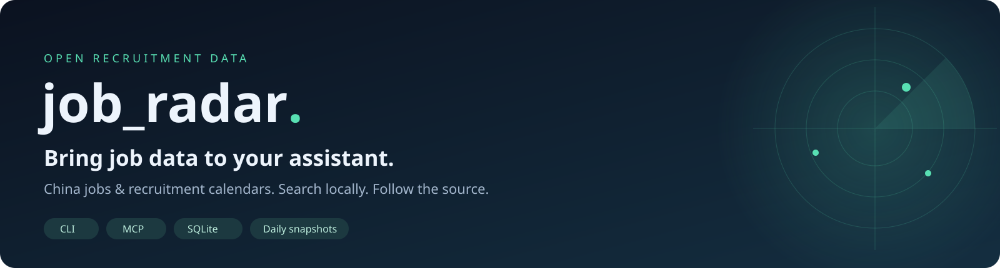
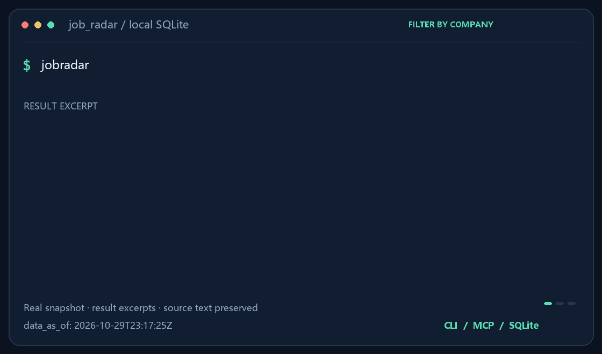

[](https://github.com/lijiaqi-AI-Product-Manager/job_radar/releases/latest) [](https://pypi.org/project/jobsearchradar/) [](https://github.com/lijiaqi-AI-Product-Manager/job_radar/actions/workflows/ci.yml) [](pyproject.toml) [](LICENSE)

[简体中文](README.md) · [English](README.en.md) · Français

**Ajoutez une compétence de recherche d’emploi à votre assistant IA habituel.**

Indiquez vos villes, métiers et contraintes. Votre assistant consulte les recrutements en Chine pour diplômés, stagiaires et professionnels, lit les exigences et fournit les liens d’origine. Privilégiez un mode agent prenant en charge les compétences ou les outils locaux.

## Démarrage rapide

Envoyez cette demande à un assistant compatible. Suivez les indications de connexion initiale, puis faites vos recherches en langage naturel.

```text
Connecte la compétence de recherche d’emploi jobradar de ce dépôt.
Vérifie d’abord la compatibilité de cet environnement. Une fois
connecté, trouve des stages en produit à Shanghai, avec exigences,
liens sources et échéances indiquées. Sépare les informations
inconnues.
https://github.com/lijiaqi-AI-Product-Manager/job_radar
```

Si un fichier est demandé, importez jobradar-skill.zip depuis la dernière Release. Les outils et les données restent à préparer après l’importation. Un simple chat web ne peut pas nécessairement exécuter des outils locaux.

[Platform routes / 平台接入](docs/PLATFORMS.md) · [Skill download](https://github.com/lijiaqi-AI-Product-Manager/job_radar/releases/latest)

<details>
<summary><strong>Configuration manuelle (pour la personne ou l’assistant qui la réalise)</strong></summary>

Le paquet PyPI s’appelle `jobsearchradar` ; la commande installée est `jobradar`. Python 3.11+ est requis. Compatible avec Windows, macOS et Linux.

```bash
pip install --upgrade "jobsearchradar"
jobradar update
jobradar search --company 复星医药 --type campus --grad-year 2027 --table
```

</details>



<sub>L’animation présente des extraits de résultats réels. Sa durée ne mesure pas la latence. Vérifiez l’état et les dates sur la page de recrutement d’origine.</sub>

## Exemples de recherche

```bash
jobradar search --text "PyTorch 大模型" --type campus --limit 3 --table
jobradar search --city 上海 --category 算法 --type intern --dedupe --table
jobradar calendar --group 阿里巴巴 --grad-year 2027 --table
jobradar diff --days 7 --types open --table
jobradar doctor
```

`--table` → table · default → JSON · `JOBRADAR_HOME` → data directory

## Données et couverture

2026-11-05 · [Methodology / 统计口径](docs/COVERAGE.md)

| Indicateur | Valeur |
| :--- | ---: |
| Sources actives | 2,230 |
| Entreprises configurées | 2,199 |
| Adaptateurs | 27 |
| Couverture du périmètre fixe d’entreprises cibles | 944 / 1,655 · 57.04% |

L’instantané vérifié du 5 novembre 2026 (UTC) contient 346 267 enregistrements, dont 320 348 ouverts. Le texte original est disponible pour 97,6 % des enregistrements ouverts. Une source configurée ne signifie pas que l’entreprise recrute aujourd’hui. Une annonce d’agrégateur peut décrire plusieurs postes.

[Latest data release](https://github.com/lijiaqi-AI-Product-Manager/job_radar/releases/tag/data-latest) · `jobradar stats`

## Connexion MCP

```bash
pip install --upgrade "jobsearchradar[mcp]"
jobradar update
```

```json
{
  "mcpServers": {
    "jobradar": {
      "command": "jobradar-mcp"
    }
  }
}
```

Ajoutez `jobradar-mcp` comme service stdio. Neuf outils couvrent recherche, détail, changements, comparaison, tendances, calendriers et statistiques. Pour un répertoire personnalisé, transmettez `JOBRADAR_HOME` dans le champ `env` du service.

## Documentation et contributions

Ajoutez des sources publiques autorisées, corrigez des dates, signalez un problème reproductible ou améliorez les traductions. Une Star ou un partage aide d’autres personnes à découvrir le projet.

[English guide](README.en.md) · [文档 / Docs](docs/README.md) · [FAQ](docs/FAQ.md) · [Contributing](CONTRIBUTING.md) · [Changelog](CHANGELOG.md)

Le code est sous licence MIT. Les droits sur les offres et les contenus tiers restent à leurs titulaires ; la licence du code n’accorde aucun droit supplémentaire sur ces contenus.

<!-- project-growth:start -->

## Évolution du projet

L’historique des Stars est actualisé chaque jour. Les dates de mise à jour sont en UTC ; celles des Stars suivent les agrégats GitHub. Les demandes quotidiennes de téléchargement sur PyPI sont également affichées.

<a href="https://github.com/lijiaqi-AI-Product-Manager/job_radar/stargazers">
<picture>
  <source media="(max-width: 600px) and (prefers-color-scheme: dark)" srcset="https://raw.githubusercontent.com/lijiaqi-AI-Product-Manager/lijiaqi-AI-Product-Manager/main/assets/growth/job_radar/stars-mobile-dark.svg">
  <source media="(max-width: 600px)" srcset="https://raw.githubusercontent.com/lijiaqi-AI-Product-Manager/lijiaqi-AI-Product-Manager/main/assets/growth/job_radar/stars-mobile-light.svg">
  <source media="(prefers-color-scheme: dark)" srcset="https://raw.githubusercontent.com/lijiaqi-AI-Product-Manager/lijiaqi-AI-Product-Manager/main/assets/growth/job_radar/stars-dark.svg">
  
</picture>
</a>

<a href="https://pypistats.org/packages/jobsearchradar">
<picture>
  <source media="(max-width: 600px) and (prefers-color-scheme: dark)" srcset="https://raw.githubusercontent.com/lijiaqi-AI-Product-Manager/lijiaqi-AI-Product-Manager/main/assets/growth/job_radar/downloads-mobile-dark.svg">
  <source media="(max-width: 600px)" srcset="https://raw.githubusercontent.com/lijiaqi-AI-Product-Manager/lijiaqi-AI-Product-Manager/main/assets/growth/job_radar/downloads-mobile-light.svg">
  <source media="(prefers-color-scheme: dark)" srcset="https://raw.githubusercontent.com/lijiaqi-AI-Product-Manager/lijiaqi-AI-Product-Manager/main/assets/growth/job_radar/downloads-dark.svg">
  
</picture>
</a>

Les demandes incluent les accès répétés et automatisés ; elles ne correspondent pas à des utilisateurs uniques ou actifs.

[Sources des données et définition des indicateurs](https://github.com/lijiaqi-AI-Product-Manager/lijiaqi-AI-Product-Manager/blob/main/docs/growth.md)

<!-- project-growth:end -->
