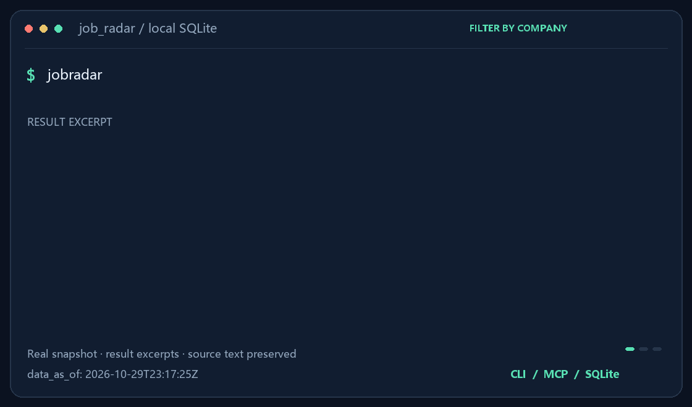

# job_radar · 中国の校招／インターン／中途採用のオープン求人データセット

[简体中文](README.md) | [English](README.en.md) | 日本語 | [한국어](README.ko.md) | [Español](README.es.md) | [Français](README.fr.md) | [Deutsch](README.de.md) | [Русский](README.ru.md)

[](CHANGELOG.md)
[](https://pypi.org/project/jobsearchradar/)
[](tests/)
[](https://github.com/lijiaqimun-coder/job_radar/releases/tag/data-latest)
[](LICENSE)

**毎日自動更新される中国の求人データセット**。各社の公式採用ページを毎日クロールし、すぐに検索できる SQLite として公開します。
CLI・MCP・Skill を同梱しているので、AI エージェントは API キーもサーバーもなしで
「どこが・何を・いつまで・どこに出願するか」を答えられます。



> **カバレッジ（2026-10-29 時点）**：**1,750 ソース**（北森 1,145 / 大易 310 / Feishu ATSX 140 / Tupu360 32 / Workday 45 ほか）·
> **1,721 社** · **23 アダプタ**。目標 **1,655 社**（20 業界 1,117 社 + 31 省級行政区 808 社）のうち **581 社（35%）** が取得可能。
> 求人数・JD カバレッジは毎日のクロールで更新されます（最新の Release を参照）。

## 特長

- ✅ 各社**公式**採用ページの求人と JD 原文（第三者の集約サイトは使いません）
- ✅ 毎日フルクロール、履歴保持（新規・クローズ・変更を追跡）
- ✅ 採用カレンダー：卒業年度・プログラム種別・職種方向・応募期間・都市・応募 URL・出典
- ❌ 全社ではありません（1,014 社中 264 社のみ求人レベル）
- ❌ 応募代行・リファラル・面接情報・給与は扱いません。CAPTCHA／ログイン／署名の回避も行いません

## クイックスタート

```bash
pip install "jobsearchradar[mcp]"

jobradar update     # 約 20 MB + 35 MB。既に最新ならダウンロードなし
jobradar search --company 腾讯 --city 深圳 --category 算法 --table
```

中国国内では Gitee ミラーを使用（失敗時は GitHub に自動フォールバック）：

```bash
jobradar update --mirror gitee
```

## できること

```bash
jobradar search --text "PyTorch 大模型" --type campus   # タイトル＋JD の全文検索
jobradar search --company 喜茶 --exclude-store          # 店舗系の求人を除外（約 8,000 件）
jobradar search --company 星巴克中国 --dedupe           # 重複 requisition を集約（variants 付き）
jobradar diff --days 7 --by category --company 腾讯     # 会社単位の新着を職種別に
jobradar calendar --group 阿里巴巴 --type 秋招 --table   # 読みやすいカレンダー表示
```

求人が無いがカレンダーには載っている会社（字節跳動・華為・小米など）では、`search` は
「データなし」ではなく `jobradar calendar --group <社名> --table` を案内します。

## AI エージェント連携

- **Claude Code**：`skill/jobradar/` を `~/.claude/skills/jobradar/` にコピー
- **MCP クライアント**（Claude Desktop / Cursor など）：コマンドは `jobradar-mcp`（stdio、9 ツール）。
  データ置き場が既定（`~/.cache/jobradar`）でない場合は MCP 設定の `env` に `JOBRADAR_HOME` を渡してください
- ライブラリとしても利用可：`from jobradar.core import queries`

## 既知の制限

| 項目 | 現状 |
|---|---|
| 目標網羅 | **579/1,655（35%）**（残り 12 社は robots／ログイン／暗号化で不可） |
| ソース | **1,750 ソース / 1,721 社**（北森 1,145、大易 310、Feishu ATSX 140、Tupu360 32、旧北森 44、Workday 45、旧大易 15、独自サイト 19） |
| 省別網羅 | 広東 18/49（37%）、浙江 13/44（30%）、江蘇 9/34（26%）、四川 9/30（30%）、山東 7/26（27%）。全表は `scripts/coverage_report.py` |
| 大手 | 阿里・騰訊・美団・網易・百度・京東・字節跳動・vivo・奇瑞・中金・BOE・海信・中国人保などは求人あり。華為はカレンダーのみ（WAF 403） |
| カレンダー項目 | 2026-10-26 の全クロール時点で 74.9% が 11 項目中 7 項目以上 |
| 応募期間 | 最も弱い項目（2026-10-26 時点で完全な期間は 0.6%）。`apply_end` は募集の最頻日を採用 |
| 重複 | 2026-10-26 時点で 9.2% が同一会社・同一タイトル・同一都市（`--dedupe` で集約） |
| 履歴 | 2026-10-19 以降。トレンド分析はまだ 5〜7 日分 |

詳細は [CLAUDE.md](CLAUDE.md)、社内プロセス文書は [docs/internal/](docs/internal/)。

## ライセンスとコンプライアンス

コードは MIT。求人内容の権利は各発表者に帰属し、本リポジトリはインデックスのみ提供します。
公開ページのみを 1 リクエスト/秒以下で取得し、CAPTCHA・ログイン・署名の回避は行いません
（[COMPLIANCE.md](COMPLIANCE.md)）。
