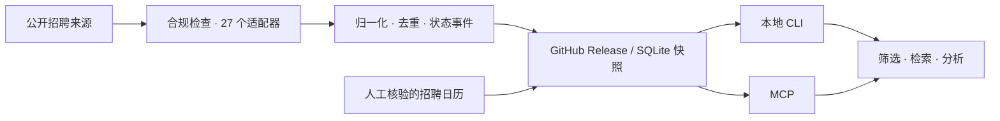

<p align="center">
  <a href="https://github.com/lijiaqi-AI-Product-Manager/job_radar/releases/tag/v2.0.0"></a>
  <a href="https://github.com/lijiaqi-AI-Product-Manager/job_radar/actions/workflows/ci.yml"></a>
  <a href="https://github.com/lijiaqi-AI-Product-Manager/job_radar/releases/tag/data-latest"></a>
  <a href="pyproject.toml"></a>
  <a href="LICENSE"></a>
</p>

<p align="center">
  简体中文 · <a href="README.en.md">English</a> · <a href="README.ja.md">日本語</a> · <a href="README.ko.md">한국어</a> · <a href="README.es.md">Español</a> · <a href="README.fr.md">Français</a> · <a href="README.de.md">Deutsch</a> · <a href="README.ru.md">Русский</a>
</p>

**中国校招、实习、社招岗位与招聘日历，下载一次，在本地查。**

把分散的公开招聘信息整理成可追溯的 SQLite 数据集。按公司、城市、届次筛选，搜索职位描述，查看招聘时间与原始投递入口。提供 CLI 和 MCP，查询无需 API key，也无需部署服务器。

<p align="center">
  <a href="#快速开始">快速开始</a> · <a href="#查询示例">查询示例</a> · <a href="#数据与覆盖">数据与覆盖</a> · <a href="docs/README.md">使用文档</a> · <a href="CONTRIBUTING.md">参与贡献</a>
</p>

## 看它如何工作


<sub>演示取自 2026-10-29 / 30 数据快照，保留来源原文，展示结果节选。动画节奏不代表查询耗时；岗位与日期请以最新数据及原始招聘页为准。</sub>

## 为什么用 job_radar

| 你想做的事 | 项目提供的能力 |
| :--- | :--- |
| 找到适合自己的岗位 | 按公司、城市、职类、校招 / 实习 / 社招、毕业年份组合筛选 |
| 阅读真正的岗位要求 | 搜索标题与 JD 原文，保留原始招聘链接 |
| 跟上招聘节奏 | 招聘日历、网申窗口，以及开岗 / 变更 / 下架历史 |
| 接入自己的工作流 | CLI 默认输出 JSON，支持表格；MCP 共用同一查询层 |
| 掌握自己的数据 | SQLite 本地查询，可离线分析；代码与数据分开发版 |
| 判断信息是否可靠 | 官方与聚合来源分开标注，缺失字段留空，统计可复算 |

## 快速开始

需要 **Python 3.11+**，支持 Windows、macOS 和 Linux。

以下命令安装 GitHub 正式版 **2.0.0**。其他发行渠道的版本以对应发行页为准。

```bash
pip install "https://github.com/lijiaqi-AI-Product-Manager/job_radar/releases/download/v2.0.0/jobsearchradar-2.0.0-py3-none-any.whl"
jobradar update
jobradar search --company 复星医药 --type campus --grad-year 2027 --table
```

包名是 **`jobsearchradar`**，安装后的命令是 **`jobradar`**。首次更新下载岗位库和正文库；后续更新会检查版本，已是最新时跳过下载。

国内网络可以使用镜像：

```bash
jobradar update --mirror gitee
```

数据默认位于 `~/.cache/jobradar`；通过 `JOBRADAR_HOME` 指定其他目录。下载、镜像与排错见 [FAQ](docs/FAQ.md)。

## 查询示例

**按条件找岗位**

```bash
# 公司 + 招聘类型 + 届次
jobradar search --company 复星医药 --type campus --grad-year 2027 --limit 3 --table

# 搜索标题与 JD 正文，多个词共同匹配
jobradar search --text "PyTorch 大模型" --type campus --limit 3 --table

# 城市、职类与去重
jobradar search --city 上海 --category 算法 --type intern --dedupe --table
```

**查看日历与最近变化**

```bash
jobradar calendar --group 阿里巴巴 --grad-year 2027 --table
jobradar diff --days 7 --types open --table
jobradar diff --days 7 --by category --company 腾讯
jobradar trends 美团 --step-days 7
```

省略 `--table` 即输出 JSON，便于脚本处理。用 `jobradar show <job_id>` 查看单岗详情与 JD；用 `jobradar doctor` 检查本地数据状态。更多参数见 `jobradar --help` 与 [字段说明](skill/jobradar/references/fields.md)。

## 接入 MCP

```bash
pip install "jobsearchradar[mcp] @ https://github.com/lijiaqi-AI-Product-Manager/job_radar/releases/download/v2.0.0/jobsearchradar-2.0.0-py3-none-any.whl"
jobradar update
```

在支持 MCP 的客户端中添加 stdio 服务：

```json
{
  "mcpServers": {
    "jobradar": {
      "command": "jobradar-mcp"
    }
  }
}
```

提供搜索、单岗详情、近期变化、职类新增、公司对比、趋势、数据状态、招聘日历和统计 **9 个工具**。自定义数据目录时，在该服务的 `env` 中传入 `JOBRADAR_HOME`；客户端需能找到安装环境中的 `jobradar-mcp`。

需要通过 CLI 集成时，可参考 [查询工作流](skill/jobradar/SKILL.md)。

## 数据与覆盖

**配置统计 · 2026-10-31**

| 指标 | 当前值 | 含义 |
| :--- | ---: | :--- |
| 启用数据源 | **2,242** | 启用的源配置 |
| 配置公司 | **2,201** | 启用源对应的去重公司 |
| 采集适配器 | **27** | 共享平台与自研站适配器 |
| 核心目标覆盖 | **931 / 1,655 · 56.25%** | 固定目标池中的配置覆盖 |
| 其中官方 / 聚合 | **606 / 325** | 优先按官方归类，不重复计数 |

**已核验发布快照 · `2026-10-29T23:17:25Z`**

共 **294,483 条岗位记录**，其中 **276,008 条在招记录**；在招 JD 正文覆盖率 **97.3%**。招聘日历样本共 **4,874 条**，含 **2,078 条人工整理条目**。这是有日期的历史快照，实时规模以本地 `jobradar stats` 和最新 [数据 Release](https://github.com/lijiaqi-AI-Product-Manager/job_radar/releases/tag/data-latest) 为准。

配置覆盖不等于当天在招；聚合招聘简章可能对应多个岗位，不能按单个职位理解。日期缺失保留为空，学校公告展示截止日与企业网申截止日分别处理。更多口径、可复算命令与已知限制见 [覆盖说明](docs/COVERAGE.md)。

<details>
<summary><strong>数据文件与更新机制</strong></summary>

| 文件 | 内容 |
| :--- | :--- |
| `jobs.db` | 结构化岗位、状态与变更事件 |
| `jd_text.db` | 岗位职责与任职要求原文 |
| `calendar.db` | 招聘项目、届次、方向、窗口与来源 |

GitHub Actions 定时采集并发布 `data-latest`，CLI 下载快照后在本地查询。失败抓取不会直接导致岗位下架。数据规模、源可用性和字段完整性随发布变化，使用时应核对 `data_as_of` 和原始链接。

主分支新增 FTS5 trigram 索引，长关键词保持字面子串语义，短词回退 LIKE。首次打开新版数据库会构建索引；约 29 万条岗位的本机样本约需 1 分钟，额外占用约 199 MB。公开数据库保留兼容格式，索引由新版客户端本地建立。详见 [发布与兼容性](docs/RELEASE.md)。

</details>

## 项目如何运行



采集运行在 GitHub Actions，查询运行在你的电脑上。核心查询集中在一处，CLI 与 MCP 共享相同筛选规则。

## 一起把它做好

欢迎补充公开招聘源、修正公司归属与招聘日期、改进适配器、提交可复现的问题，或完善翻译。

```bash
git clone https://github.com/lijiaqi-AI-Product-Manager/job_radar.git
cd job_radar
uv sync --frozen --all-extras
uv run pytest
uv run ruff check .
```

从 [贡献指南](CONTRIBUTING.md)、[开发规范](docs/DEVELOPMENT.md) 和 [路线图](docs/ROADMAP.md) 开始。问题反馈请附命令、数据时间与原始来源链接，帮助维护者快速定位。

如果它帮你少翻了几个招聘网站，欢迎 **Star**，也欢迎分享给正在找工作的朋友。

## 文档与许可

[文档索引](docs/README.md) · [常见问题](docs/FAQ.md) · [覆盖说明](docs/COVERAGE.md) · [更新日志](CHANGELOG.md) · [合规声明](COMPLIANCE.md)

代码采用 [MIT License](LICENSE)。招聘文本与来源站点内容的权利归原权利人；代码许可不构成对第三方内容的额外授权。项目只访问允许公开读取的内容，不绕过登录、验证码或访问限制。详见 [数据使用说明](docs/DATA-LICENSE.md)。
