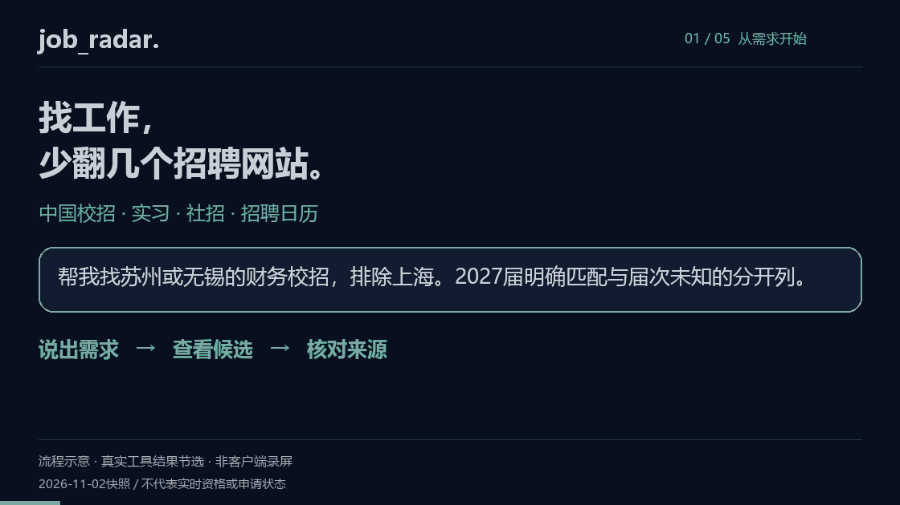
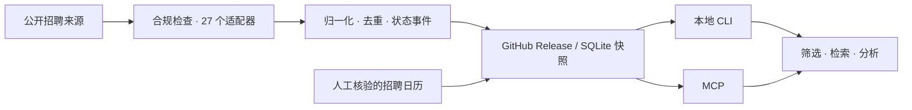

<p align="center">
  <a href="https://github.com/lijiaqi-AI-Product-Manager/job_radar/releases/tag/v2.2.1"></a>
  <a href="https://pypi.org/project/jobsearchradar/"></a>
  <a href="https://github.com/lijiaqi-AI-Product-Manager/job_radar/actions/workflows/ci.yml"></a>
  <a href="https://github.com/lijiaqi-AI-Product-Manager/job_radar/releases/tag/data-latest"></a>
  <a href="https://github.com/lijiaqi-AI-Product-Manager/job_radar/blob/main/pyproject.toml"></a>
  <a href="https://github.com/lijiaqi-AI-Product-Manager/job_radar/blob/main/LICENSE"></a>
</p>

<p align="center">
  简体中文 · <a href="https://github.com/lijiaqi-AI-Product-Manager/job_radar/blob/main/README.en.md">English</a> · <a href="https://github.com/lijiaqi-AI-Product-Manager/job_radar/blob/main/README.ja.md">日本語</a> · <a href="https://github.com/lijiaqi-AI-Product-Manager/job_radar/blob/main/README.ko.md">한국어</a> · <a href="https://github.com/lijiaqi-AI-Product-Manager/job_radar/blob/main/README.es.md">Español</a> · <a href="https://github.com/lijiaqi-AI-Product-Manager/job_radar/blob/main/README.fr.md">Français</a> · <a href="https://github.com/lijiaqi-AI-Product-Manager/job_radar/blob/main/README.de.md">Deutsch</a> · <a href="https://github.com/lijiaqi-AI-Product-Manager/job_radar/blob/main/README.ru.md">Русский</a>
</p>

**对助手说出你的求职需求，查中国校招、实习、社招与招聘日历。**

把分散在企业招聘站和公开招聘公告里的信息，整理成可追溯的本地索引。按城市、公司、方向与届次发现机会，读原始 JD，核对日期，再回到来源页确认投递。适合找校招的应届生、找实习的在校生，以及寻找社招机会的求职者。

**接入支持 MCP / skill 的助手后，日常查询只需对话。** 数据在本地，提供 CLI 与 MCP 两种入口；查询工具不需要 API key。你使用的助手由其服务方单独提供。

<p align="center">
  <a href="#快速开始">快速开始</a> · <a href="#查询示例">查询示例</a> · <a href="#数据与覆盖">数据与覆盖</a> · <a href="https://github.com/lijiaqi-AI-Product-Manager/job_radar/blob/main/docs/README.md">使用文档</a> · <a href="https://github.com/lijiaqi-AI-Product-Manager/job_radar/blob/main/CONTRIBUTING.md">参与贡献</a>
</p>

## 你可以这样问

> “苏州、无锡都可以，帮我找财务校招；排除上海，把2027届明确匹配和届次没写的分开。”

> “帮我比较这几个岗位的学历要求，字段与正文有冲突的请指出依据。”

> “看看招聘日历里哪些项目有明确网申窗口，哪些还需要去官网确认。”



<sub>流程示意采用实际工具返回的结果节选，非第三方客户端录屏。原始数据时间与演示范围见[素材说明](https://github.com/lijiaqi-AI-Product-Manager/job_radar/blob/main/docs/SHOWCASE.md)；播放节奏不代表查询耗时，候选不等于资格已确认。</sub>

## 为什么用 job_radar

| 你想做的事 | 项目提供的能力 |
| :--- | :--- |
| 找到适合自己的岗位 | 多城市并集，排除城市、公司和标题词；按招聘类型、职类与毕业年份组合筛选 |
| 阅读真正的岗位要求 | 搜索标题与 JD 原文，保留原始招聘链接 |
| 跟上招聘节奏 | 招聘日历、网申窗口，以及开岗 / 变更 / 下架历史 |
| 接入自己的工作流 | CLI 默认输出 JSON，支持表格；MCP 共用同一查询层 |
| 掌握自己的数据 | SQLite 本地查询，可离线分析；代码与数据分开发版 |
| 判断信息是否可靠 | 官方与聚合来源分开标注，提示字段缺失与学历冲突，统计可复算 |

## 快速开始

需要 **Python 3.11+**，支持 Windows、macOS 和 Linux。首次完成下面的配置后，即可在兼容助手中对话查询。详细排错见[首次使用指南](https://github.com/lijiaqi-AI-Product-Manager/job_radar/blob/main/docs/GETTING-STARTED.md)。

**1. 安装工具，下载本地数据**

```bash
pip install --upgrade "jobsearchradar[mcp]==2.2.1"
jobradar update
```

**2. 在助手中添加 MCP 服务**

在客户端的 MCP 配置中添加 stdio 服务；不同客户端的配置入口可能不同：

```json
{
  "mcpServers": {
    "jobradar": {
      "command": "jobradar-mcp"
    }
  }
}
```

**3. 新建对话，说出你的条件**

例如：“帮我找上海的算法实习，列出原始链接、数据时间和需要核实的要求。”客户端需能找到安装环境里的 `jobradar-mcp`；找不到命令时使用可执行文件的绝对路径。也可让支持 skill 的助手按[查询工作流](https://github.com/lijiaqi-AI-Product-Manager/job_radar/blob/main/skill/jobradar/SKILL.md)调用 CLI。

包名是 **`jobsearchradar`**，命令是 **`jobradar` / `jobradar-mcp`**。首次更新需要联网下载三库；下载后可以离线查询，后续执行 `jobradar update` 检查新快照。默认目录为 `~/.cache/jobradar`，可通过 `JOBRADAR_HOME` 修改。

当前推荐 GitHub 数据渠道。2026-11-03 核查时 Gitee 镜像入口返回 404，暂不作为可用下载承诺；npm 暂无本项目发行包。详见[安装渠道](https://github.com/lijiaqi-AI-Product-Manager/job_radar/blob/main/docs/DISTRIBUTION.md)。

只使用终端时，安装 `jobsearchradar==2.2.1` 后运行 `jobradar search --company 复星医药 --type campus --limit 3 --table` 即可开始。

## 查询示例

**按条件找岗位**

```bash
# 公司 + 招聘类型 + 届次
jobradar search --company 复星医药 --type campus --grad-year 2027 --limit 3 --table

# 搜索标题与 JD 正文，多个词共同匹配
jobradar search --text "PyTorch 大模型" --type campus --limit 3 --table

# 城市、职类与去重
jobradar search --city 上海 --category 算法 --type intern --dedupe --table

# 可选城市取并集，排除含上海的多城市记录
jobradar search --cities 苏州 无锡 --exclude-city 上海 --category 财务 --table
```

**查看日历与最近变化**

```bash
jobradar calendar --group 阿里巴巴 --grad-year 2027 --table
jobradar diff --days 7 --types open --table
jobradar diff --days 7 --by category --company 腾讯
jobradar trends 美团 --step-days 7
```

省略 `--table` 即输出 JSON，便于脚本处理。用 `jobradar show <job_id>` 查看单岗详情与 JD；用 `jobradar doctor` 检查本地数据状态。更多参数见 `jobradar --help` 与 [字段说明](https://github.com/lijiaqi-AI-Product-Manager/job_radar/blob/main/skill/jobradar/references/fields.md)。

CLI / MCP 默认折叠相同展示分组，`variants` 保留原条数；查看全部记录用 `--no-dedupe`。
按届次或截止日筛选时，即使有结果也会提示未标注字段的范围。未知候选与明确匹配分别说明，不能把关键词命中当作资格保证。详见[个人条件查询](https://github.com/lijiaqi-AI-Product-Manager/job_radar/blob/main/docs/CANDIDATE-SEARCH.md)。

## 接入 MCP

提供搜索、单岗详情、近期变化、职类新增、公司对比、趋势、数据状态、招聘日历和统计 **9 个工具**。安装配置见[快速开始](#快速开始)。自定义数据目录时，在该服务的 `env` 中传入 `JOBRADAR_HOME`；MCP 与 CLI 共用查询规则。

薪资、经验、每周实习天数和远程等精细条件需要读取详情逐条核实，不能将全文词语命中直接写成“满足要求”。缺失日期和资格条件会保留未知。更多示例见[个人条件查询](https://github.com/lijiaqi-AI-Product-Manager/job_radar/blob/main/docs/CANDIDATE-SEARCH.md)。

## 数据与覆盖

**配置统计 · 2026-11-03**

| 指标 | 当前值 | 含义 |
| :--- | ---: | :--- |
| 启用数据源 | **2,262** | 启用的源配置 |
| 配置公司 | **2,223** | 启用源对应的去重公司 |
| 采集适配器 | **27** | 共享平台与自研站适配器 |
| 核心目标覆盖 | **950 / 1,655 · 57.40%** | 固定目标池中的配置覆盖 |
| 其中官方 / 聚合 | **604 / 346** | 优先按官方归类，不重复计数 |

**已核验发布快照 · `2026-11-02T14:39:29Z`**

共 **298,631 条岗位记录**，其中 **277,567 条在招记录**；在招 JD 正文覆盖率 **97.3%**。招聘日历样本共 **5,135 条**，含 **2,078 条人工整理条目**。这是有日期的历史快照，实时规模以本地 `jobradar stats` 和最新 [数据 Release](https://github.com/lijiaqi-AI-Product-Manager/job_radar/releases/tag/data-latest) 为准。

配置覆盖不等于当天在招；聚合招聘简章可能对应多个岗位，不能按单个职位理解。日期缺失保留为空，学校公告展示截止日与企业网申截止日分别处理。更多口径、可复算命令与已知限制见 [覆盖说明](https://github.com/lijiaqi-AI-Product-Manager/job_radar/blob/main/docs/COVERAGE.md)。

<details>
<summary><strong>数据文件与更新机制</strong></summary>

| 文件 | 内容 |
| :--- | :--- |
| `jobs.db` | 结构化岗位、状态与变更事件 |
| `jd_text.db` | 岗位职责与任职要求原文 |
| `calendar.db` | 招聘项目、届次、方向、窗口与来源 |

GitHub Actions 定时采集并发布 `data-latest`，CLI 下载快照后在本地查询。失败抓取不会直接导致岗位下架。数据规模、源可用性和字段完整性随发布变化，使用时应核对 `data_as_of` 和原始链接。

2.1 默认直接查询兼容快照，已有 FTS5 trigram 索引时继续复用。需要反复全文检索时，可用 `jobradar update --prepare-index` 在新快照中准备索引，完成后再切换活动数据。详见 [发布与兼容性](https://github.com/lijiaqi-AI-Product-Manager/job_radar/blob/main/docs/RELEASE.md)。

</details>

## 项目如何运行



采集运行在 GitHub Actions，查询运行在你的电脑上。核心查询集中在一处，CLI 与 MCP 共享相同筛选规则。

## 一起把它做好

欢迎补充公开招聘源、修正公司归属与招聘日期、改进适配器、提交可复现的问题，或完善翻译。

```bash
git clone https://github.com/lijiaqi-AI-Product-Manager/job_radar.git
cd job_radar
uv sync --frozen --all-extras
uv run pytest
uv run ruff check .
```

从 [贡献指南](https://github.com/lijiaqi-AI-Product-Manager/job_radar/blob/main/CONTRIBUTING.md)、[开发规范](https://github.com/lijiaqi-AI-Product-Manager/job_radar/blob/main/docs/DEVELOPMENT.md) 和 [路线图](https://github.com/lijiaqi-AI-Product-Manager/job_radar/blob/main/docs/ROADMAP.md) 开始。问题反馈请附命令、数据时间与原始来源链接，帮助维护者快速定位。

如果它帮你少翻了几个招聘网站，欢迎 **Star**，也欢迎分享给正在找工作的朋友。

## 文档与许可

[文档索引](https://github.com/lijiaqi-AI-Product-Manager/job_radar/blob/main/docs/README.md) · [常见问题](https://github.com/lijiaqi-AI-Product-Manager/job_radar/blob/main/docs/FAQ.md) · [覆盖说明](https://github.com/lijiaqi-AI-Product-Manager/job_radar/blob/main/docs/COVERAGE.md) · [更新日志](https://github.com/lijiaqi-AI-Product-Manager/job_radar/blob/main/CHANGELOG.md) · [合规声明](https://github.com/lijiaqi-AI-Product-Manager/job_radar/blob/main/COMPLIANCE.md)

代码采用 [MIT License](https://github.com/lijiaqi-AI-Product-Manager/job_radar/blob/main/LICENSE)。招聘文本与来源站点内容的权利归原权利人；代码许可不构成对第三方内容的额外授权。项目只访问允许公开读取的内容，不绕过登录、验证码或访问限制。详见 [数据使用说明](https://github.com/lijiaqi-AI-Product-Manager/job_radar/blob/main/docs/DATA-LICENSE.md)。
