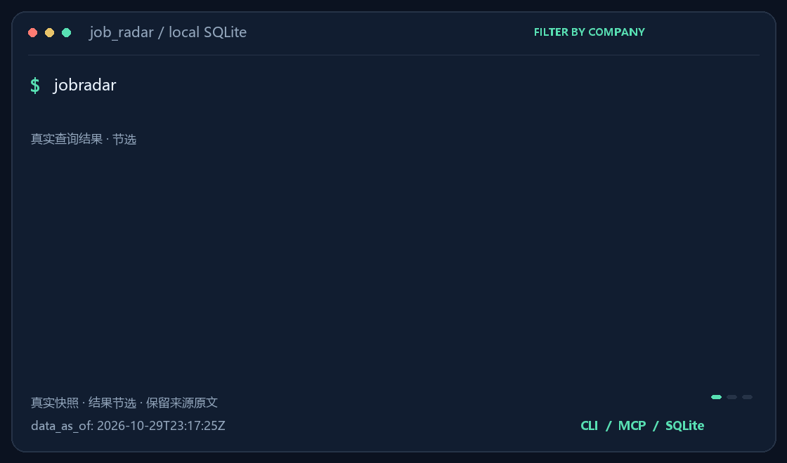

# job_radar · 中国校招/实习/社招岗位开放数据集

简体中文 | [English](README.en.md) | [日本語](README.ja.md) | [한국어](README.ko.md) | [Español](README.es.md) | [Français](README.fr.md) | [Deutsch](README.de.md) | [Русский](README.ru.md)

[](CHANGELOG.md)
[](https://pypi.org/project/jobsearchradar/)
[](tests/)
[](https://github.com/lijiaqimun-coder/job_radar/releases/tag/data-latest)
[](LICENSE)
[](pyproject.toml)

**每天自动更新的中国岗位数据集**：各公司官方招聘页 → 每天采集 → 发布成可直接查询的 SQLite。
配套 CLI / MCP / Skill，让 AI agent 不用接口、不用 API key、零服务器就能查「谁在招、招什么、什么时候截止、去哪投」。



> **当前数据（2026-10-26 发布）**
> **465 个数据源** · **147,656 个在招岗位**（校园 40,104 / 实习 11,286 / 社招 96,266）· **JD 正文 100.0%** · **55,138 个岗位带城市** · **2,511 个岗位带截止日**
> 目标公司 **1,014 家**：日历覆盖 **891 家**（1,474 条人工条目 + 786 条数据层自动条目），数据源覆盖 **387 家**，覆盖合计 **895 家**
> 自检：`uv run python scripts/release_check.py --home ~/.cache/jobradar`（8 项门槛全绿）

## 这是什么 / 不是什么

- ✅ 各公司**官方**招聘页的岗位与 JD 原文（不含第三方聚合站）
- ✅ 每天全量重采、保留历史（下架、新开、变更都能回溯）
- ✅ 招聘日历：届次、项目类型、方向、网申时间、城市、投递入口、来源
- ❌ 不是「所有公司」：1,014 家目标里只有 264 家能拿到岗位级数据；其余靠日历覆盖，未覆盖的 119 家如实列出（见[已知限制](#覆盖与已知限制诚实版)）
- ❌ 不做投递、内推、面经、薪资；不绕过验证码/登录/签名

## 30 秒上手

```bash
pip install "jobsearchradar[mcp]"

jobradar update                        # 下载最新数据（约 20 MB + 35 MB；已是最新则秒回、0 下载）
jobradar search --company 复星 --type campus --grad-year 2027 --table
```

国内网络走 Gitee 镜像（失败自动回退 GitHub）：

```bash
jobradar update --mirror gitee        # 或 export JOBRADAR_MIRROR=gitee
```

> PyPI 包名是 **`jobsearchradar`**（`jobradar` 已被占用），装完命令仍然是 `jobradar`；
> 数据不走 PyPI，装好后跑一次 `jobradar update` 从 Release / Gitee 下载。

## 能问什么

```bash
jobradar search --text "PyTorch 大模型" --type campus    # 全文检索：标题 + JD 原文
jobradar search --company 腾讯 --city 深圳 --category 算法 --table
jobradar search --company 喜茶 --exclude-store           # 排掉门店/零售岗（这类约 8 千条）
jobradar search --company 星巴克中国 --dedupe            # 同一岗位的多条 req 折叠成一条，带 variants
jobradar diff --days 7 --types open                     # 近 7 天新开的岗位
jobradar diff --days 7 --by category --company 腾讯      # 某公司新增按职类分布（不再混入全库）
jobradar compare 公司A 公司B --category 算法            # 取同类岗位 JD 原文对比
jobradar trends 美团 --step-days 7                      # 在招数量随时间变化
jobradar show <job_id>                                  # 单岗详情（含 JD 原文）
```

招聘日历（**搜不到岗位时也会引导到这里**）：

```bash
jobradar calendar --group 阿里巴巴 --type 秋招 --table
```

```text
# data_as_of: 2026-10-24T06:12:33Z  (2 条)

阿里巴巴 · 2027届 · 秋招
  公司/产品：阿里巴巴集团
  方向：技术类（智能算法、Agent Infra 工程师…）
  网申：来源未写（不代表已截止）
  城市：北京、上海、广州、深圳、杭州、成都
  入口：https://campus-talent.alibaba.com/campus/position
  来源：阿里巴巴校园招聘官网（岗位页）
  JD：可在 search 里查到 JD
```

`calendar` 是给「官网能看到岗位、但 JD 接口被验证码/签名挡住」的大厂准备的：只发日历信息，
末尾带一句 `{公司名}希望你去他们的招聘页逛一逛哦~`。

搜索「字节跳动」「华为」「小米」这类只做日历的公司时，`search` 不再只回"数据里没有"，
而是返回 `calendar` 字段 + 提示 `jobradar calendar --group 字节跳动 --table`。

## 接 agent

- **Claude Code**：把 `skill/jobradar/` 复制到 `~/.claude/skills/jobradar/`，agent 会通过 CLI 查询，
  并遵守回答规则（注明数据时间、附链接、`company_match` 为 `none` 时不能说"这家公司没在招"）。
- **MCP 客户端**（Claude Desktop / Cursor 等）：命令填 `jobradar-mcp`（stdio），9 个工具。
  数据目录不是默认的 `~/.cache/jobradar` 时，要在 MCP 配置的 `env` 里传 `JOBRADAR_HOME`，
  否则 MCP 会去找默认目录并报「本地没有数据」。
- 也可以直接当库用：`from jobradar.core import queries`

## 数据文件

数据发布在 Release `data-latest`（Gitee 有同日镜像，大文件按 `.partNN` 分片）：

| 文件 | 大小 | 内容 |
|---|---|---|
| `jobs.db.gz` | 20 MB | 岗位主库（岗位、公司、事件、数据源状态） |
| `jd_text.db.gz` | 35 MB | 岗位职责与要求原文（全文检索用） |
| `calendar.db.gz` | 约 1.1 MB | 招聘日历（1,014 家目标公司，2,425 条条目） |
| `crawl-summary.json` | 32 KB | 每个源的状态、新增/下架数 |

- 每日 UTC 19:17（北京时间 03:17）采集，采集完成后自动发布新 Release；Gitee 镜像同日同步
- 下架判定：连续 3 次成功抓取中缺席；抓取失败**不会**导致岗位下架
- 字段说明：[skill/jobradar/references/fields.md](skill/jobradar/references/fields.md)
- 数据许可：代码 MIT；岗位内容权利归原发布方，本库只做索引（草案见 [docs/DATA-LICENSE.md](docs/DATA-LICENSE.md)）

## 覆盖与已知限制（诚实版）

| 维度 | 现状 |
|---|---|
| 目标公司日历 | 891/1,014；17 家（BOSS直聘/猎聘/智联/前程无忧/微博/招商蛇口等）因 robots/登录墙/域名失效不可合规覆盖，证据见 [docs/internal/COVERAGE-PLAN.md](docs/internal/COVERAGE-PLAN.md) |
| 数据源 | 387/1,014 家能抓到岗位级数据；其余多为自研站、加密平台（Moka/飞书 ATSX）或 Workday 之外的外企系统 |
| 头部大厂 | 阿里/腾讯/美团/网易/百度/京东/字节/vivo/奇瑞/中金/京东方/海信/中国人保等有岗位数据；华为目前只有日历（WAF 403） |
| JD 正文 | 99.8%（抓不到正文的源不进数据集；比例按在招岗位算） |
| 日历字段完整度 | 全部条目 **74.9%** 达到「11 个必填字段里 ≥7 个」；按集团 **60.7%（362/596 个集团）**；纯人工条目 38.0% |
| 网申时间 | 只有 **8/1372 条（0.6%）** 带完整网申起止（纯人工条目 1.8%）：官网多数只写「9 月起」 |
| 重复岗位 | **9.2%**（8,115/88,608）是「同公司+同标题+同城市」的多条 req；`search --dedupe` 可折叠 |
| 门店岗噪声 | 喜茶、星巴克门店帖约 8 千条；`search --exclude-store` 可排掉 |
| 历史 | 从 2026-10-19 开始积累，趋势类问题目前只能看 5–7 天 |

不做的事：不爬第三方聚合站、不绕过验证码/登录/签名、不伪造 UA、不在流水线里用 LLM、不持久化任何凭据。

## 架构

```text
GitHub Actions（每日 UTC 19:17 = 北京时间 03:17）
  ├─ crawl        465 个源 → 适配器（北森 / 大易 / Workday / 自研站）→ SQLite
  ├─ calendar     日历库：人工条目（A/B/C 三档）+ 数据层自动条目
  ├─ release      打包 gzip 上传 Release data-latest（+ 每周归档，保留 8 周）
  └─ mirror       同步到 Gitee 发行版（国内加速）

本地
  jobradar update     ← Release / Gitee（自动回退、gzip 与 SQLite 完整性校验、增量跳过）
  jobradar <query>    ← 纯本地 SQLite 查询（CLI / MCP / Skill 共用同一套查询层）
```

## 参与贡献

```bash
uv sync --all-extras
uv run pytest                              # 504 个测试函数全绿
uv run ruff check .
uv run python scripts/check_docs_links.py  # 文档断链 / 版本 / 安装说法一致性
uv run python scripts/release_check.py --home ~/.jobradar   # 8 项发布门槛
```

- 新增一家北森门户公司：在 [sources/beisen.yaml](sources/beisen.yaml) 加一行（`id/company/params.tenant`）
- 新增适配器：按 [CLAUDE.md](CLAUDE.md) 的流程（侦察 → fixtures → 专属测试），一个适配器一次提交
- 内部过程文档（阶段验收、进度记录、评审处置、覆盖计划）在 [docs/internal/](docs/internal/)，不面向使用者

## 合规

只访问公开、无需登录的页面/接口；每源 ≤1 请求/秒；每源都有 `compliance` 记录（robots、条款、核查日期）。
收到来源方的删除/停止请求会先停用再沟通。详见 [COMPLIANCE.md](COMPLIANCE.md)。

## 文档

[FAQ](docs/FAQ.md) · [施工规范](CLAUDE.md) · [路线图](docs/ROADMAP.md) · [发布门槛](docs/RELEASE.md) ·
[日历字段规范](docs/CALENDAR-FORMAT.md) · [日历来源规则](docs/CALENDAR.md) · [PyPI 发布](docs/PUBLISHING.md) ·
[数据许可](docs/DATA-LICENSE.md) · [评测集](evals/) · [变更日志](CHANGELOG.md) · [文档索引](docs/README.md)
