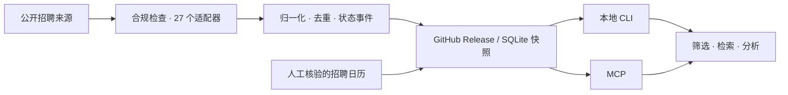

<p align="center">
  <a href="https://github.com/lijiaqi-AI-Product-Manager/job_radar/releases/latest"></a>
  <a href="https://pypi.org/project/jobsearchradar/"></a>
  <a href="https://github.com/lijiaqi-AI-Product-Manager/job_radar/actions/workflows/ci.yml"></a>
  <a href="https://github.com/lijiaqi-AI-Product-Manager/job_radar/releases/tag/data-latest"></a>
  <a href="https://github.com/lijiaqi-AI-Product-Manager/job_radar/blob/main/pyproject.toml"></a>
  <a href="https://github.com/lijiaqi-AI-Product-Manager/job_radar/blob/main/LICENSE"></a>
</p>

<p align="center">
  简体中文 · <a href="https://github.com/lijiaqi-AI-Product-Manager/job_radar/blob/main/README.en.md">English</a> · <a href="https://github.com/lijiaqi-AI-Product-Manager/job_radar/blob/main/README.ja.md">日本語</a> · <a href="https://github.com/lijiaqi-AI-Product-Manager/job_radar/blob/main/README.ko.md">한국어</a> · <a href="https://github.com/lijiaqi-AI-Product-Manager/job_radar/blob/main/README.es.md">Español</a> · <a href="https://github.com/lijiaqi-AI-Product-Manager/job_radar/blob/main/README.fr.md">Français</a> · <a href="https://github.com/lijiaqi-AI-Product-Manager/job_radar/blob/main/README.de.md">Deutsch</a> · <a href="https://github.com/lijiaqi-AI-Product-Manager/job_radar/blob/main/README.ru.md">Русский</a>
</p>

**给你常用的 AI 助手，加一个找工作的技能。**

你说想去哪里、做什么、有什么条件，助手帮你查中国校招、实习、社招与招聘日历，读岗位要求，再把候选和来源链接整理给你。适合应届生、在校实习生和寻找社招机会的求职者。

**推荐通过 Agent 平台的技能或 MCP 接入，日常使用直接聊需求。** WorkBuddy、千问办公可从技能导入开始；Kimi 的本地 Agent 模式、Claude Desktop、ChatGPT 等按客户端能力选择接入路径。扣子、智谱清言等平台的适用条件见[平台说明](https://github.com/lijiaqi-AI-Product-Manager/job_radar/blob/main/docs/PLATFORMS.md)。首次按平台提示准备工具和数据，之后不用记命令或参数。

<p align="center">
  <a href="#快速开始">快速开始</a> · <a href="#查询示例">查询示例</a> · <a href="#数据与覆盖">数据与覆盖</a> · <a href="https://github.com/lijiaqi-AI-Product-Manager/job_radar/blob/main/docs/README.md">使用文档</a> · <a href="https://github.com/lijiaqi-AI-Product-Manager/job_radar/blob/main/CONTRIBUTING.md">参与贡献</a>
</p>

## 你可以这样问

> “苏州、无锡都可以，帮我找财务校招；排除上海，把2027届明确匹配和届次没写的分开。”

> “帮我比较这几个岗位的学历要求，字段与正文有冲突的请指出依据。”

> “看看招聘日历里哪些项目有明确网申窗口，哪些还需要去官网确认。”


<sub>流程示意采用实际工具返回的结果节选，非第三方客户端录屏。原始数据时间与演示范围见[素材说明](https://github.com/lijiaqi-AI-Product-Manager/job_radar/blob/main/docs/SHOWCASE.md)；播放节奏不代表查询耗时，候选不等于资格已确认。</sub>

## 为什么用 job_radar

| 你想做的事 | 项目提供的能力 |
| :--- | :--- |
| 找到适合自己的岗位 | 多城市并集，排除城市、公司和标题词；按招聘类型、职类与毕业年份组合筛选 |
| 阅读真正的岗位要求 | 搜索标题与 JD 原文，保留原始招聘链接 |
| 跟上招聘节奏 | 招聘日历、网申窗口，以及开岗 / 变更 / 下架历史 |
| 沿用熟悉的助手 | 完成首次接入后，用自然语言提问、补充条件和比较候选 |
| 减少重复翻找 | 在同一工作流中查询岗位、原始要求、近期变化与招聘日历 |
| 判断信息是否可靠 | 官方与聚合来源分开标注，提示字段缺失与学历冲突，统计可复算 |

## 快速开始

代码包与招聘数据分开下载。正文采用无损精简存储，默认自动清理无读者的旧快照；全部岗位关联和观测时间保留。[下载与空间说明](https://github.com/lijiaqi-AI-Product-Manager/job_radar/blob/main/docs/STORAGE.md)。

**1. 打开你常用助手中支持技能或本地工具的 Agent 工作模式。** 不确定选哪个？先看[平台接入说明](https://github.com/lijiaqi-AI-Product-Manager/job_radar/blob/main/docs/PLATFORMS.md)。

**2. 把这段话发给它，跟随平台提示完成首次接入。**

```text
请帮我接入这个仓库里的 jobradar 求职搜索技能：
https://github.com/lijiaqi-AI-Product-Manager/job_radar
先阅读接入说明，检查当前平台是否支持；完成后，帮我找上海的产品实习，列
出岗位要求、来源链接和已注明的截止日期，没写清的信息单独说明。
```

需要上传文件时，从[当前代码 Release](https://github.com/lijiaqi-AI-Product-Manager/job_radar/releases/latest)下载 **`jobradar-skill.zip`**，或导入仓库的 `skill/jobradar` 文件夹。技能包内有助手需要的准备步骤；导入说明后仍需安装查询工具和下载数据。

**3. 之后直接说需求，也可以继续追问。**

> “换成深圳，还是产品实习。把没写截止日期的单独列出来。”

成功接入后，助手应实际查询并给出候选、来源链接和数据时间。普通网页聊天或只接受远程服务地址的模式可能需要换用兼容入口；不能只凭读过仓库介绍就当作已经接入。[完整首次使用指南](https://github.com/lijiaqi-AI-Product-Manager/job_radar/blob/main/docs/GETTING-STARTED.md)中有说明。

Skill 是助手的求职查询说明，MCP 是它调用工具的连接方式，选平台支持的一种即可。查询工具不需要单独的 API key；你使用的助手可能按其套餐收费。项目不要求上传简历，不代投。

<details>
<summary><strong>手动安装与本地 MCP 配置（给负责配置的人或助手）</strong></summary>

需要 Python 3.11+，支持 Windows、macOS 和 Linux：

```bash
python -m pip install --upgrade "jobsearchradar[mcp]"
jobradar update
jobradar doctor
```

在兼容客户端添加本地 stdio 服务，具体顶层字段以客户端界面为准：

```json
{
  "mcpServers": {
    "jobradar": {
      "command": "jobradar-mcp"
    }
  }
}
```

客户端需能找到安装环境里的可执行文件，找不到时使用其绝对路径。自定义数据目录时，在服务 `env` 中设置同一 `JOBRADAR_HOME`。技能路径也可按[查询工作流](https://github.com/lijiaqi-AI-Product-Manager/job_radar/blob/main/skill/jobradar/SKILL.md)直接调用本地工具，无需同时配置 MCP。

包名为 `jobsearchradar`，命令为 `jobradar` / `jobradar-mcp`。首次更新需联网下载岗位、正文与日历三库，需预留下载和解压空间；下载后本地查询可离线使用。后续让助手检查并更新快照；默认目录为 `~/.cache/jobradar`。只用终端可安装 `jobsearchradar`。

当前推荐默认的 GitHub 数据渠道；Gitee 与 npm 的核查状态见[安装渠道](https://github.com/lijiaqi-AI-Product-Manager/job_radar/blob/main/docs/DISTRIBUTION.md)。[安装与排错](https://github.com/lijiaqi-AI-Product-Manager/job_radar/blob/main/docs/INSTALLATION.md)提供环境检查和固定源码备用方式。

</details>

## 查询示例

日常使用可直接说“找上海算法实习”“看看这周新开的岗位”“对比这几家公司的要求”。下面的命令供助手和终端使用者参考。

<details>
<summary><strong>查看命令与参数示例</strong></summary>

**按条件找岗位**

```bash
# 公司 + 招聘类型 + 届次
jobradar search --company 复星医药 --type campus --grad-year 2027 --limit 3 --table

# 搜索标题与 JD 正文，多个词共同匹配
jobradar search --text "PyTorch 大模型" --type campus --limit 3 --table

# 城市、职类与去重
jobradar search --city 上海 --category 算法 --type intern --dedupe --table

# 可选城市取并集，排除含上海的多城市记录
jobradar search --cities 苏州 无锡 --exclude-city 上海 --category 财务 --table
```

**查看日历与最近变化**

```bash
jobradar calendar --group 阿里巴巴 --grad-year 2027 --table
jobradar diff --days 7 --types open --table
jobradar diff --days 7 --by category --company 腾讯
jobradar trends 美团 --step-days 7
```

省略 `--table` 即输出 JSON，便于脚本处理。用 `jobradar show <job_id>` 查看单岗详情与 JD；用 `jobradar doctor` 检查本地数据状态。更多参数见 `jobradar --help` 与 [字段说明](https://github.com/lijiaqi-AI-Product-Manager/job_radar/blob/main/skill/jobradar/references/fields.md)。

明确截止日过后，岗位会按北京时间自动退出默认搜索；历史记录保留，日期未知不推定过期。来源健康摘要与搜索使用相同的在招口径。

每条候选会区分来源刷新与岗位自身的观测；本轮未再次见到的岗位保留为待核实历史记录。

CLI / MCP 默认折叠相同展示分组，`variants` 保留原条数；查看全部记录用 `--no-dedupe`。
按届次或截止日筛选时，即使有结果也会提示未标注字段的范围。未知候选与明确匹配分别说明，不能把关键词命中当作资格保证。详见[个人条件查询](https://github.com/lijiaqi-AI-Product-Manager/job_radar/blob/main/docs/CANDIDATE-SEARCH.md)。

</details>

## 助手可以调用哪些能力

提供搜索、单岗详情、近期变化、职类新增、公司对比、趋势、数据状态、招聘日历和统计 **9 个工具**。技能与 MCP 两种接入方式共用查询规则；首次接入见[快速开始](#快速开始)。

薪资、经验、每周实习天数和远程等精细条件需要读取详情逐条核实，不能将全文词语命中直接写成“满足要求”。缺失日期和资格条件会保留未知。更多示例见[个人条件查询](https://github.com/lijiaqi-AI-Product-Manager/job_radar/blob/main/docs/CANDIDATE-SEARCH.md)。

## 数据与覆盖

**配置统计 · 2026-11-14**

| 指标 | 当前值 | 含义 |
| :--- | ---: | :--- |
| 启用数据源 | **2,230** | 启用的源配置 |
| 配置公司 | **2,199** | 启用源对应的去重公司 |
| 采集适配器 | **27** | 共享平台与自研站适配器 |
| 核心目标覆盖 | **944 / 1,655 · 57.04%** | 固定目标池中的配置覆盖 |
| 其中官方 / 聚合 | **598 / 346** | 优先按官方归类，不重复计数 |

**已核验发布快照 · `2026-11-14T00:19:59Z`**

共 **354,560 条岗位记录**，其中 **320,124 条可见记录**；对应 JD 正文覆盖率 **97.6%**。招聘日历样本共 **5,617 条**，含 **2,078 条人工整理条目**。这是有日期的历史快照，实时规模以本地 `jobradar stats` 和最新 [数据 Release](https://github.com/lijiaqi-AI-Product-Manager/job_radar/releases/tag/data-latest) 为准。

配置覆盖不等于当天在招；聚合招聘简章可能对应多个岗位，不能按单个职位理解。日期缺失保留为空，学校公告展示截止日与企业网申截止日分别处理。更多口径、可复算命令与已知限制见 [覆盖说明](https://github.com/lijiaqi-AI-Product-Manager/job_radar/blob/main/docs/COVERAGE.md)。

<details>
<summary><strong>数据文件与更新机制</strong></summary>

| 文件 | 内容 |
| :--- | :--- |
| `jobs.db` | 结构化岗位、状态与变更事件 |
| `jd_text.db` | 岗位职责与任职要求原文 |
| `calendar.db` | 招聘项目、届次、方向、窗口与来源 |

GitHub Actions 定时采集并发布 `data-latest`，CLI 下载快照后在本地查询。失败抓取不会直接导致岗位下架。数据规模、源可用性和字段完整性随发布变化，使用时应核对 `data_as_of` 和原始链接。

2.1 默认直接查询兼容快照，已有 FTS5 trigram 索引时继续复用。需要反复全文检索时，可用 `jobradar update --prepare-index` 在新快照中准备索引，完成后再切换活动数据。详见 [发布与兼容性](https://github.com/lijiaqi-AI-Product-Manager/job_radar/blob/main/docs/RELEASE.md)。

</details>

## 项目如何运行



采集运行在 GitHub Actions，查询运行在你的电脑上。核心查询集中在一处，CLI 与 MCP 共享相同筛选规则。

## 一起把它做好

欢迎补充公开招聘源、修正公司归属与招聘日期、改进适配器、提交可复现的问题，或完善翻译。

```bash
git clone https://github.com/lijiaqi-AI-Product-Manager/job_radar.git
cd job_radar
uv sync --frozen --all-extras
uv run pytest
uv run ruff check .
```

从 [贡献指南](https://github.com/lijiaqi-AI-Product-Manager/job_radar/blob/main/CONTRIBUTING.md)、[开发规范](https://github.com/lijiaqi-AI-Product-Manager/job_radar/blob/main/docs/DEVELOPMENT.md) 和 [路线图](https://github.com/lijiaqi-AI-Product-Manager/job_radar/blob/main/docs/ROADMAP.md) 开始。问题反馈请附原始提问或操作步骤、数据时间与来源链接；如知道所用客户端，也请一并说明，帮助维护者快速定位。

如果它帮你少翻了几个招聘网站，欢迎 **Star**，也欢迎分享给正在找工作的朋友。

## 文档与许可

[文档索引](https://github.com/lijiaqi-AI-Product-Manager/job_radar/blob/main/docs/README.md) · [常见问题](https://github.com/lijiaqi-AI-Product-Manager/job_radar/blob/main/docs/FAQ.md) · [覆盖说明](https://github.com/lijiaqi-AI-Product-Manager/job_radar/blob/main/docs/COVERAGE.md) · [更新日志](https://github.com/lijiaqi-AI-Product-Manager/job_radar/blob/main/CHANGELOG.md) · [合规声明](https://github.com/lijiaqi-AI-Product-Manager/job_radar/blob/main/COMPLIANCE.md)

代码采用 [MIT License](https://github.com/lijiaqi-AI-Product-Manager/job_radar/blob/main/LICENSE)。招聘文本与来源站点内容的权利归原权利人；代码许可不构成对第三方内容的额外授权。项目只访问允许公开读取的内容，不绕过登录、验证码或访问限制。详见 [数据使用说明](https://github.com/lijiaqi-AI-Product-Manager/job_radar/blob/main/docs/DATA-LICENSE.md)。

<!-- project-growth:start -->

## 项目增长

Star 历史每天自动更新。更新日期采用 UTC，Star 日期沿用 GitHub 聚合口径。 同时展示 PyPI 每日下载请求量。

<a href="https://github.com/lijiaqi-AI-Product-Manager/job_radar/stargazers">
<picture>
  <source media="(max-width: 600px) and (prefers-color-scheme: dark)" srcset="https://raw.githubusercontent.com/lijiaqi-AI-Product-Manager/lijiaqi-AI-Product-Manager/main/assets/growth/job_radar/stars-mobile-dark.svg">
  <source media="(max-width: 600px)" srcset="https://raw.githubusercontent.com/lijiaqi-AI-Product-Manager/lijiaqi-AI-Product-Manager/main/assets/growth/job_radar/stars-mobile-light.svg">
  <source media="(prefers-color-scheme: dark)" srcset="https://raw.githubusercontent.com/lijiaqi-AI-Product-Manager/lijiaqi-AI-Product-Manager/main/assets/growth/job_radar/stars-dark.svg">
  
</picture>
</a>

<a href="https://pypistats.org/packages/jobsearchradar">
<picture>
  <source media="(max-width: 600px) and (prefers-color-scheme: dark)" srcset="https://raw.githubusercontent.com/lijiaqi-AI-Product-Manager/lijiaqi-AI-Product-Manager/main/assets/growth/job_radar/downloads-mobile-dark.svg">
  <source media="(max-width: 600px)" srcset="https://raw.githubusercontent.com/lijiaqi-AI-Product-Manager/lijiaqi-AI-Product-Manager/main/assets/growth/job_radar/downloads-mobile-light.svg">
  <source media="(prefers-color-scheme: dark)" srcset="https://raw.githubusercontent.com/lijiaqi-AI-Product-Manager/lijiaqi-AI-Product-Manager/main/assets/growth/job_radar/downloads-dark.svg">
  
</picture>
</a>

下载请求包含重复与自动化访问，不等于独立用户或活跃用户。

[数据来源与统计口径](https://github.com/lijiaqi-AI-Product-Manager/lijiaqi-AI-Product-Manager/blob/main/docs/growth.md)

<!-- project-growth:end -->
